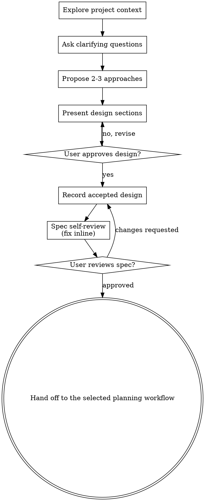

# Brainstorming Ideas Into Designs

Help turn ideas into fully formed designs and specs through natural collaborative dialogue.

Start by understanding the current project context, then ask questions one at a time to refine the idea. Once you understand what you're building, present the design and get user approval.

Resolve missing behavior and consequential design choices before implementation.
Reuse approved specifications and decisions; do not demand a new design or
approval cycle for a clear, bounded change already authorized by the user.
Keep small clarifications inline. Write a separate spec only when durable
behavior or a consequential decision needs a canonical owner.

## Checklist

Use these steps only when needed; do not create tracking artifacts for the
discussion itself or repeat completed approval steps:

1. **Explore project context** — check files, docs, recent commits
2. **Offer the visual companion just-in-time** — NOT upfront. The first time a question would genuinely be clearer shown than described, offer it then (its own message); on approval its browser tab opens for you. If no visual question ever arises, never offer it. See the Visual Companion section below.
3. **Ask clarifying questions** — one at a time, understand purpose/constraints/success criteria
4. **Compare approaches when there is a real choice** — brief trade-offs and a recommendation
5. **Present design** — brief enough for one decision; ask approval for unresolved consequential choices
6. **Record the accepted design** — use the repository's canonical product or design artifact
7. **Spec self-review** — quick inline check for placeholders, contradictions, ambiguity, scope (see below)
8. **Resolve unapproved choices** — do not repeat approval for already agreed behavior
9. **Transition to implementation** — use the repository's planning workflow when implementation is approved

## Process Flow

**The terminal state is an accepted design and a clear handoff.** Use
`writing-plans` when durable sequencing, coordination, or recovery needs a plan.
Otherwise follow the repository's existing planning and implementation rules.

## The Process

**Understanding the idea:**

- Check out the current project state first (files, docs, recent commits)
- Before asking detailed questions, assess scope: if the request describes multiple independent subsystems (e.g., "build a platform with chat, file storage, billing, and analytics"), flag this immediately. Don't spend questions refining details of a project that needs to be decomposed first.
- If the project is too large for a single spec, help the user decompose into sub-projects: what are the independent pieces, how do they relate, what order should they be built? Then brainstorm the first sub-project through the normal design flow. Each sub-project gets its own spec → plan → implementation cycle.
- For appropriately-scoped projects, ask questions one at a time to refine the idea
- Prefer multiple choice questions when possible, but open-ended is fine too
- Only one question per message - if a topic needs more exploration, break it into multiple questions
- Focus on understanding: purpose, constraints, success criteria

**Exploring approaches:**

- Compare alternatives only when they materially change outcome, cost, or risk
- Present options conversationally with your recommendation and reasoning
- Lead with your recommended option and explain why
- YAGNI ruthlessly - remove unnecessary features from every approach and design

**Presenting the design:**

- Once you believe you understand what you're building, present the design
- Scale each section to its complexity: a few sentences if straightforward, up to 200-300 words if nuanced
- Ask about unresolved consequential choices; avoid approval after every paragraph
- Cover: architecture, components, data flow, error handling, testing
- Be ready to go back and clarify if something doesn't make sense

**Design for isolation and clarity:**

- Break the system into smaller units that each have one clear purpose, communicate through well-defined interfaces, and can be understood and tested independently
- For each unit, you should be able to answer: what does it do, how do you use it, and what does it depend on?
- Can someone understand what a unit does without reading its internals? Can you change the internals without breaking consumers? If not, the boundaries need work.
- Smaller, well-bounded units are also easier for you to work with - you reason better about code you can hold in context at once, and your edits are more reliable when files are focused. When a file grows large, that's often a signal that it's doing too much.

**Working in existing codebases:**

- Explore the current structure before proposing changes. Follow existing patterns.
- Where existing code has problems that affect the work (e.g., a file that's grown too large, unclear boundaries, tangled responsibilities), include targeted improvements as part of the design - the way a good developer improves code they're working in.
- Don't propose unrelated refactoring. Stay focused on what serves the current goal.

## After the Design

**Documentation:**

- Read `AGENTS.md` and existing product, design, and plan documents before
  selecting an output path.
- Write the validated design in the repository-native artifact that already owns
  the behavior. When Harness is active, link the selected design source
  from the selected task or tracker instead of creating a parallel spec tree.
- If the owner or location is unclear, use `agent-docs-architect` when it is
  installed to propose the artifact map; otherwise record the unresolved
  decision and do not invent a path. If it is known, use `agent-docs-writer`
  when installed or write the selected repository-native artifact directly.
- Do not create `docs/superpowers/` or commit the design unless the repository
  policy or user explicitly requires it.
- Give the document a brief clarity pass; preserve technical meaning and
  exact identifiers without adding a separate writing workflow.

**Spec Self-Review:**
After writing the spec document, look at it with fresh eyes:

1. **Gap scan:** Identify missing critical behavior; ask its owner rather than inventing rules.
2. **Internal consistency:** Do any sections contradict each other? Does the architecture match the feature descriptions?
3. **Scope check:** Is this focused enough for a single implementation plan, or does it need decomposition?
4. **Ambiguity check:** If behavior has several interpretations, ask its decision owner instead of silently choosing.

Repair bounded editorial issues inline. Resolve behavior or decision gaps with
their owner; do not rewrite a spec merely to legitimize incorrect implementation.

**User Review Gate:**
When the written spec introduces an unapproved consequential choice, ask for review:

> "The accepted design is recorded at `<path>`. Please review it and let me know if you want changes before implementation planning."

Wait when the written spec introduces an unresolved or unapproved choice.
Do not force another approval round when it only records already approved
behavior and the user has authorized implementation.

**Implementation:**

- Use `writing-plans` when durable sequencing, coordination, or recovery needs a plan.
- Otherwise use the repository's existing plan format or proceed only under its
  explicit implementation rules.

## Visual Companion

A browser-based companion for showing mockups, diagrams, and visual options during brainstorming. Available as a tool — not a mode. Accepting the companion means it's available for questions that benefit from visual treatment; it does NOT mean every question goes through the browser.

**Offering the companion (just-in-time):** Do NOT offer it upfront. Wait until a question would genuinely be clearer shown than told — a real mockup / layout / diagram question, not merely a UI *topic*. The first time that happens, offer it then, as its own message:
> "This next part might be easier if I show you — I can put together mockups, diagrams, and comparisons in a browser tab as we go. It's still new and can be token-intensive. Want me to? I'll open it for you."

**This offer MUST be its own message.** Only the offer — no clarifying question, summary, or other content. Wait for the user's response. If they accept, start the server with `--open` so their browser opens to the first screen automatically. If they decline, continue text-only and don't offer again unless they raise it.

**Per-question decision:** Even after the user accepts, decide FOR EACH QUESTION whether to use the browser or the terminal. The test: **would the user understand this better by seeing it than reading it?**

- **Use the browser** for content that IS visual — mockups, wireframes, layout comparisons, architecture diagrams, side-by-side visual designs
- **Use the terminal** for content that is text — requirements questions, conceptual choices, tradeoff lists, A/B/C/D text options, scope decisions

A question about a UI topic is not automatically a visual question. "What does personality mean in this context?" is a conceptual question — use the terminal. "Which wizard layout works better?" is a visual question — use the browser.

If they agree to the companion, read the detailed guide before proceeding:
`skills/brainstorming/visual-companion.md`
